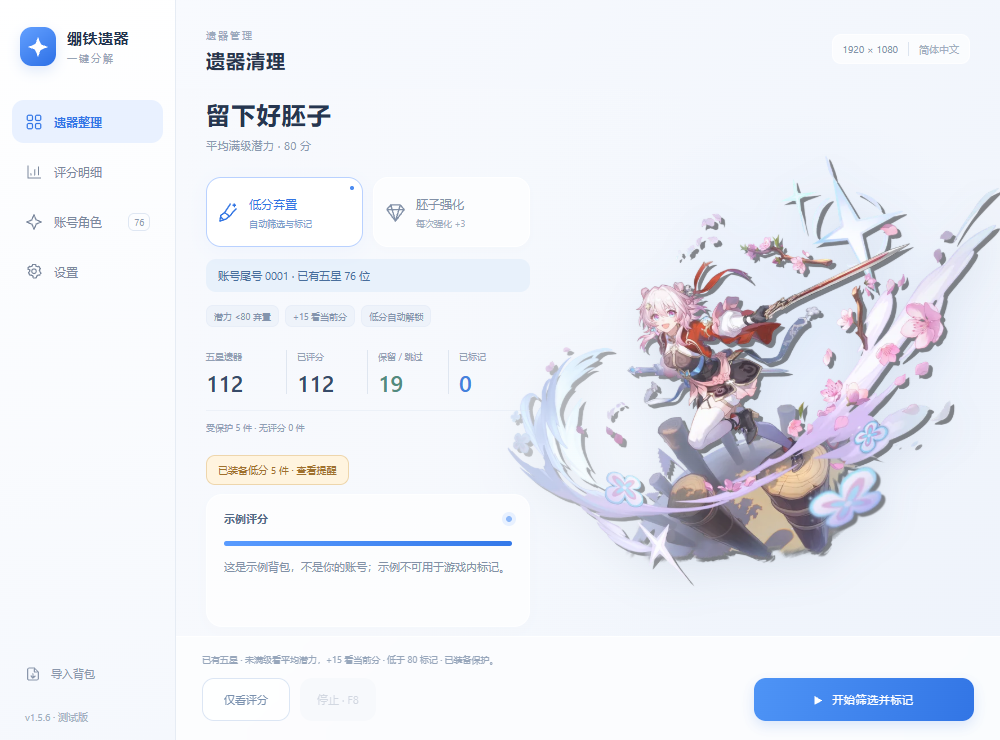
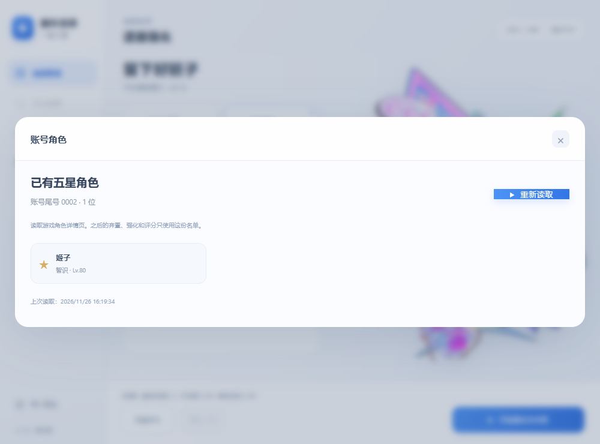

# 绷铁遗器一键分解

Windows 简体中文客户端的遗器整理工具。只按当前账号已有五星角色的 Fribbels 权重评分，低分自动解锁并标记弃置，分解由玩家确认。

**[下载 v1.5.6 测试版：EXE＋中文说明](https://github.com/piqiumanager/hsr-relic-manager/releases/download/v1.5.6/hsr-relic-manager-v1.5.6-windows.zip)** · [发布页](https://github.com/piqiumanager/hsr-relic-manager/releases/tag/v1.5.6)

ZIP 内只有 EXE 和说明，模型与 59 张官网角色立绘内置，无需 Python、Node 或另下素材。



## 使用

1. 游戏使用 **1920×1080 客户区、简体中文、PC 键鼠模式**，停在主界面或手机菜单。
2. 打开 EXE，在“账号角色”中点击“读取角色”。工具逐个读取已拥有角色的详情，保存五星名单。
3. 先“开始筛选并标记”，再“开始强化并弃置”。游戏无需重新登录。
4. 最后在游戏中自行确认分解。



## 账号五星

“账号角色”显示已读取名单，并提供重新读取按钮。新抽角色或切换账号后重新读取。后续清理、逐档强化、导入文件评分和历史评分统一使用该名单，不能选择全部角色代替。

每次开始会核对当前账号 UID；名单未完成、账号不一致或已有五星缺少评分权重时停止。失败或中断的刷新不能恢复旧名单。角色读取只进入手机菜单和角色详情，不操作遗器。

## 筛选与强化

- 未满级看平均满级潜力，**低于 80 标记弃置**；已锁定的先解锁，再核验标记。
- +15 看当前分，**低于 80 标记弃置，达到 80 保留**。
- 已装备的低分件保留，界面单独提醒。状态不明或识别不完整的跳过。
- 每次强化到下一个 +3 节点后重新评分，掉分就停止消耗并标记，高分继续到 +15。非整档等级先补到下一节点。
- 只允许经验材料和未锁定、未装备的四星及以下遗器，禁止使用五星。

“仅看评分”不修改遗器。F8 或“停止”结束。识别不清、材料不足或停止导致的未完成项目单独列出，不能假报全部完成。

## 通用高速保护

目前仅保护风套 **晨昏交界的翔鹰** 的下列遗器：

- 速度主词条的鞋。
- 副速度 ≥10 的遗器。
- 未满级、已有速度副词条，且剩余强化仍可能达到副速度 10 的胚子。初始三词条会扣除解锁第四词条的一次机会；隐藏小数按保守上界处理。

保护优先于角色低分判断，评分和实际弃置执行都检查。普通低速风套继续按 80 分处理，其他套装没有额外豁免。受保护的未满级胚子单独列出，角色潜力不足时不自动花材料试速。已有弃置标记的高速件会提示先手动取消。

## 界面

背景每次启动随机更换，不连续重复，固定 82% 不透明度；已移除选图、换图和背景选择页。评分明细支持当前分、平均潜力和理论上限排序。


## 验证与开发

32 组基础离线套件、3 组无界面浏览器流程及完整 3000 件模拟背包回归通过。包含账号名单限制、停止与重试、风套高速保护、真实评分和文件通信代码。**本轮未操作真实游戏，实际账号菜单、角色顶栏、解锁弃置及材料菜单仍待实机复测，本版继续为测试版。** [验证记录](docs/VALIDATION.md)。

```powershell
powershell.exe -NoProfile -ExecutionPolicy Bypass -File scripts/prepare-ocr.ps1
node source/repack.mjs
node scripts/run-offline-tests.cjs --ocr --stress
# 界面测试需单独的合成账号 DataRoot，并拦截全部游戏 API：
node scripts/test-roster-ui.cjs
node scripts/test-live-ui.cjs
node scripts/test-upgrade-ui.cjs
powershell.exe -NoProfile -ExecutionPolicy Bypass -File desktop/build.ps1
```

本机数据在 %LOCALAPPDATA%\HSRRelicManager\data；名单为 account-roster.json，任务记录在 marker-runs。需要管理员权限及 WebView2 Runtime，截图与账号信息不上传。

AGPL-3.0；第三方依赖、官方图片和参考实现说明见 licenses。角色读取参考说明见 [ROSTER_PROVENANCE.json](source/ROSTER_PROVENANCE.json)。
