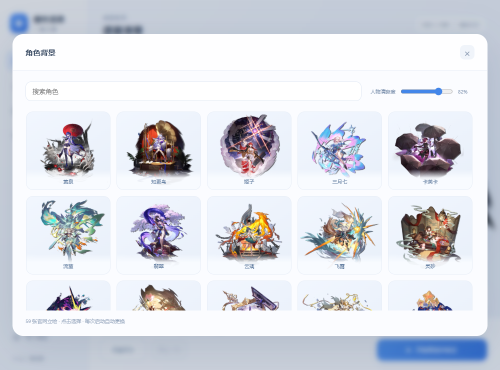

# 绷铁遗器一键分解

Windows 简体中文客户端的遗器整理工具。按已收录五星角色的 Fribbels 权重评分，自动标记低分遗器，分解由玩家确认。

**[下载 v1.5.2 测试版：EXE＋中文说明](https://github.com/piqiumanager/hsr-relic-manager/releases/download/v1.5.2/hsr-relic-manager-v1.5.2-windows.zip)** · [发布页](https://github.com/piqiumanager/hsr-relic-manager/releases/tag/v1.5.2)

ZIP 内只有一个 EXE 和说明，模型与背景已内置，无需 Python、Node 或另下素材。


## 新界面

紧凑圆角侧栏、两种任务切换、底部固定操作区和右侧角色立绘。评分明细与设置统一重新排版。



## 一键筛选

1. 游戏使用 **1920×1080 客户区、简体中文、PC 键鼠模式**，停在主界面或遗器背包。
2. 关闭旧工具，打开新 EXE，确认管理员授权。
3. 点击 **开始筛选并标记**，无需重新登录。

清理规则：

- **未满级平均满级潜力 <80：标记弃置。已锁定的先解锁，再核验并标记。**
- 平均潜力 ≥80：保留，不再要求同时满足理论上限。
- **+15：跳过。**
- 已装备、锁定状态不明或不能可靠评分的遗器跳过，并显示原因。

按目标五星中最高的平均满级潜力判断。画面隐藏小数使用可能值区间核验。旧版 70/85 设置会切换到本版规则。

“仅看评分”不会解锁或标记。开始筛选时逐件操作当前游戏，进度显示本次已标记数量及跳过原因。**F8** 或“停止”结束，分解在游戏中自行确认。

评分明细默认高分在前，支持当前分、平均潜力、理论上限排序，重复点击切换升降序。


## 角色背景

内置 **59 张女性角色官网立绘**，本版再补充 26 张，包含镜流、符玄、阮·梅、黑天鹅、花火、银狼、布洛妮娅等。每次启动随机更换，不连续重复；也可在“角色背景”中搜索和选择。

右侧清晰立绘与左侧操作分开，默认不透明度 **82%**。点击人物旁的“换一张”切换，在“角色背景”中调节清晰度，选择会保存。图片全部从本机读取。完整名单和官网地址见 [credits.json](source/backgrounds/credits.json)。

## 强化与测试范围

强化沿用逐次 +3：未满级平均潜力 ≥80 继续，满级当前分 ≥80 保留，低分仅标弃置。允许经验材料与未锁定、未装备的四星及以下遗器，禁止消耗五星。强化前需取得本次完整读取快照。

本版通过 80 分边界、+15 跳过、解锁后核验及标记、异常中止、界面和离线识别测试。实际游戏解锁、弃置和强化完整流程尚未完成端到端验证，继续作为测试版；详情见 [验证记录](docs/VALIDATION.md)。

## 数据与开发

截图和背包在本机处理。界面需要 Microsoft WebView2 Runtime，启动时需要管理员授权。数据目录为 `%LOCALAPPDATA%\HSRRelicManager\data`，任务截图与操作记录在 `marker-runs`。

```powershell
powershell.exe -NoProfile -ExecutionPolicy Bypass -File scripts/prepare-ocr.ps1
node source/repack.mjs
node scripts/test-engine.cjs
node scripts/test-live-flow.cjs
node scripts/test-background.cjs
powershell.exe -NoProfile -ExecutionPolicy Bypass -File scripts/test-live-core.ps1
powershell.exe -NoProfile -ExecutionPolicy Bypass -File scripts/test-live-executor.ps1
powershell.exe -NoProfile -ExecutionPolicy Bypass -File scripts/test-live-bridge.ps1
powershell.exe -NoProfile -ExecutionPolicy Bypass -File desktop/build.ps1
```

浏览器集成测试 `scripts/test-live-ui.cjs` 需要 Playwright、Chrome 和独立测试服务，游戏操作接口均使用模拟响应。开发构建会下载并校验固定版本依赖，运行源码和构建脚本随 EXE 内置。

## 许可

整体 [AGPL-3.0](LICENSE)，第三方许可见 [licenses](licenses)。

- [Fribbels](https://github.com/fribbels/hsr-optimizer)：评分核心与角色权重，MIT。
- [Reliquary Archiver](https://github.com/IceDynamix/reliquary-archiver)：JSON 导入与保留的登录抓取接口，MIT；日常标记无需重登。
- [HSR-Scanner](https://github.com/kel-z/HSR-Scanner)：布局、导航和装备边框参考，GPL-3.0。
- [Tesseract.js](https://github.com/naptha/tesseract.js)、[Tesseract.js-core](https://github.com/naptha/tesseract.js-core)、[tessdata_fast](https://github.com/tesseract-ocr/tessdata_fast)：离线数字识别，Apache-2.0。
- [StarRailRes](https://github.com/Mar-7th/StarRailRes)：遗器单件名称，AGPL-3.0。

角色美术来自星穹铁道官网，版权归米哈游及相关权利人，不适用代码许可。本项目与游戏官方无隶属关系。
