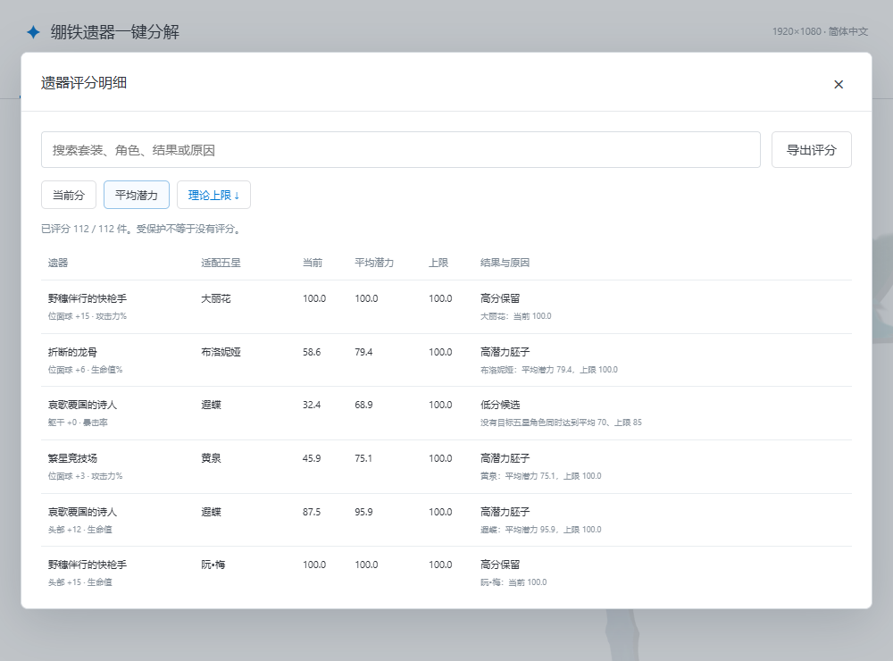

# 绷铁遗器一键分解

Windows 简体中文客户端的遗器整理工具。按已收录五星角色的 Fribbels 权重评分，低分遗器只标记弃置，分解由玩家确认。

## 下载 v1.5.0 测试版

**[下载 EXE 和中文说明](https://github.com/piqiumanager/hsr-relic-manager/releases/download/v1.5.0/hsr-relic-manager-v1.5.0-windows.zip)** · [发布页](https://github.com/piqiumanager/hsr-relic-manager/releases/tag/v1.5.0)

ZIP 只有一个 EXE 和说明。内置读取、评分和离线识别组件，不需要 Python、Node 或另下模型。启动时确认一次管理员授权，界面需要微软 WebView2 Runtime。


## v1.5 更新

- “开始标记”可直接启动当前背包的扫描、评分和标记，不再要求先抓取本次登录数据；没有新快照时按钮也能点击。
- “读取当前背包”只扫描和评分；“仅预览”不修改遗器。两种方式都不要求退出或重新登录游戏。
- 评分明细默认当前分从高到低，支持当前分、平均潜力、理论上限三个排序按钮，再次点击切换升序。
- 修复属性名称和数值被拆成两行、小数点分离、等级和数字漏读的问题。中文标签使用 Windows OCR，数字使用内置离线识别模型。
- 装备状态同时检查文字与详情底部边框，无法确认的状态保持保护。数字不完整、点击前后属性改变或弃置结果未确认时跳过或停止。
- 修复连续任务的状态监听竞争、停止后的迟到评分和角色列表空值问题。部分读取会明确显示，不作为完整背包。

**已验证既有游戏画面的只读识别，并通过后台界面、执行函数和服务交互测试。当前屏幕遍历及实际弃置点击仍未完成真实游戏端到端验证，本版继续标为测试版。**

## 使用

1. 游戏使用 **1920×1080 客户区、简体中文、PC 键鼠模式**，停在游戏主界面或遗器背包。
2. 关闭旧版工具，打开新 EXE，确认管理员授权。
3. 选择“低分弃置”，直接点“开始标记”。也可先用“读取当前背包”查看评分，或勾选“仅预览”核对识别。
4. 自动操作时保持游戏在前台。**F8** 或“停止”结束。游戏内自行检查弃置列表并确认分解。

默认保留满级当前分 ≥75 的遗器；胚子需要平均满级潜力 ≥70 且上限 ≥85。可以在设置修改。只评估已收录五星角色；锁定、装备、已弃置及状态不明的遗器不会自动标记。画面隐藏小数会按可能值区间处理，仍可能达标的遗器保留。

扫描中断后显示已读取部分，不冒充完整背包。再次开始标记会重新核验当前画面。离线 JSON 及上次评分可查看明细；标记过程使用当前游戏属性。



## 强化测试功能

强化模块沿用逐次 +3 流程：未满级平均满级潜力 ≥80 继续，+15 当前分 ≥80 保留，低分只标弃置；允许经验材料和未锁定、未装备的四星及以下遗器。

强化前需完成本次完整读取并取得有效快照。该模块尚未完成真实游戏全流程验证，材料规则或界面识别不确定会停止；本次修复不代表强化功能已稳定。

## 数据与开发

背包和截图在本机处理。模型随 EXE 内置，运行识别不向外发送图片。数据目录为 `%LOCALAPPDATA%\HSRRelicManager\data`，测试详情见 [VALIDATION](docs/VALIDATION.md)。

```powershell
powershell.exe -NoProfile -ExecutionPolicy Bypass -File scripts/prepare-ocr.ps1
node source/repack.mjs
node scripts/test-engine.cjs
node scripts/test-live-flow.cjs
node scripts/test-ocr-assets.cjs
powershell.exe -NoProfile -ExecutionPolicy Bypass -File scripts/test-live-core.ps1
powershell.exe -NoProfile -ExecutionPolicy Bypass -File scripts/test-live-executor.ps1
powershell.exe -NoProfile -ExecutionPolicy Bypass -File scripts/test-live-bridge.ps1
powershell.exe -NoProfile -ExecutionPolicy Bypass -File desktop/build.ps1
```

开发构建会下载并校验固定版本的官方组件、识别模型及 WebView2 SDK。完整开发源码在仓库中，运行代码和许可随 EXE 内置。可选浏览器集成测试 `scripts/test-live-ui.cjs` 需要 Playwright、Chrome 和独立测试服务，所有游戏操作接口均使用模拟响应。

## 许可

整体 [AGPL-3.0](LICENSE)，第三方许可见 [licenses](licenses)。

- [Fribbels](https://github.com/fribbels/hsr-optimizer)：评分核心与五星角色权重，MIT。
- [Reliquary Archiver](https://github.com/IceDynamix/reliquary-archiver)：保留完整 JSON 导入与登录抓取接口，MIT；日常标记不依赖重新登录抓取。
- [HSR-Scanner](https://github.com/kel-z/HSR-Scanner)：布局、导航和装备边框识别参考，GPL-3.0。
- [Tesseract.js](https://github.com/naptha/tesseract.js)、[Tesseract.js-core](https://github.com/naptha/tesseract.js-core)、[tessdata_fast](https://github.com/tesseract-ocr/tessdata_fast)：离线数字识别，Apache-2.0；版本和校验值见 `source/ocr/PROVENANCE.json`。
- [StarRailRes](https://github.com/Mar-7th/StarRailRes)：遗器单件名称资料，AGPL-3.0。

界面参考 MAA 的白底蓝色布局。六位女性角色背景来自星穹铁道官网，淡色显示、每次启动更换，地址和美术版权声明见 [credits.json](source/backgrounds/credits.json)。本项目与游戏官方无隶属关系，不执行分解确认。
